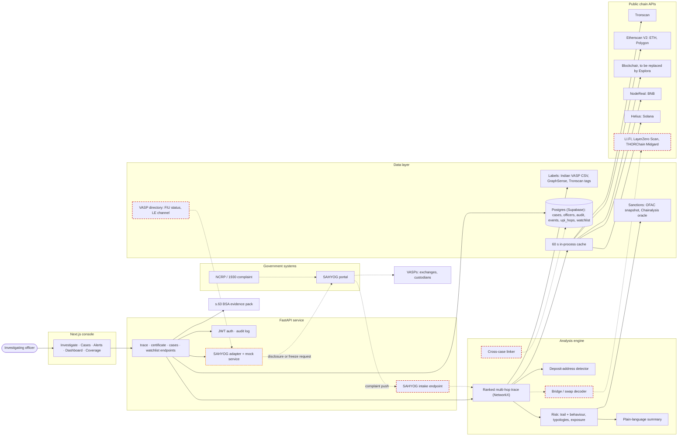

# VASP-Trace — SIH26182 End-to-End Review

Reviewed **2026-09-26 → 27**: branch `main` at `1628879` plus the uncommitted working tree.

The review is read-only. The code was run offline (tests, probes) and live (API smoke test with no database writes). Nothing in the repo was changed; the only new files are in `docs/sih-review/`.

**Companion files**
- `COVERAGE.md` — the requirement matrix (Step 2).
- `RESEARCH.md` — web research with source URLs and an evidence label on every claim (Step 3).
- `PS_SIH26182.md` — the problem statement.

## Executive summary

1. **Verdict:** a real, honest attribution prototype — a real Indian-case Tron wallet traced to "Binance-Hot 7" in 3 s, with deposit-address evidence and an India-specific evidence layer. Not finale-ready yet: 6 reproducible correctness bugs, misrouted legal instruments, and 2 missing compulsory items.
2. **Compulsory coverage: 30% strict** (6 of 20 fully done) / **57.5% weighted** (Partial = ½). 11 partial, 1 mocked (SAHYOG routing), 2 missing (DeFi bridges, cross-chain swap services). Optional: 3 of 5 done.
3. **Strength 1:** live, ranked multi-hop tracing that names the *deposit address* (the thing a VASP can answer about). Behaviour-based risk flags a scam wallet even when the trail ends at a compliant exchange.
4. **Strength 2:** outputs no foreign tool emits — BSA s.63 Part A/B certificate pack with a reproducible SHA-256, NCRP/CCTNS case fields, UPI money-trail, BNSS instrument routing.
5. **Strength 3:** discipline — 257 offline tests pass in 4 s, every label carries provenance, thresholds are published, and "unattributed ≠ clean" / "not consulted ≠ clear" hold end to end.
6. **Gaps 1–2:** no bridge/swap identification or cross-chain mapping. SAHYOG is draft-only, and routing sends FIU-registered CoinDCX/WazirX to "s.63 certificate only". It never separates disclosure (BNSS s.94) from freeze (s.106/s.107, where the 2026 High Courts disagree).
7. **Gaps 3–5:**
   - Forensic correctness: no temporal ordering; 81,815 uncategorised labels (incl. Tornado pools, "upbit hack") typed as *exchanges* with risk "none"; confidence ignores label quality; deposit overclaim.
   - Uneven chains: BTC dead without a key (Blockchair HTTP 430); BNB native-only; Solana unlabelled; only 45 static Tron labels (30 GraphSense + 15 curated).
   - No cross-case or scale layer.
8. **Action 1 (1–2 days):** fix the 6 bugs and the routing (request type drives the instrument; registered list from the Lok Sabha answer + FIU-IND waves).
9. **Action 2 (2–3 days):** build **cross-case linking via shared deposit addresses** and a **VASP routing directory** — the two recommended differentiators.
10. **Action 3 (3 days):** bridge/swap MVP (registry + THORChain memo + LI.FI/LayerZero lookups + "continue on chain Y"); swap Blockchair for Esplora; then a clearly labelled SAHYOG mock service for the demo.

---

## Contents

1. [Codebase inventory (Step 1)](#1-codebase-inventory-step-1)
4. [Feature decisions (Step 4)](#4-feature-decisions-step-4)
5. [Minimum viable versions of the hard parts (Step 5)](#5-minimum-viable-versions-of-the-hard-parts-step-5)
6. [End-to-end solution (Step 6)](#6-end-to-end-solution-step-6)
7. [SIH strategy (Step 7)](#7-sih-strategy-step-7)
8. [Action plan (Step 8)](#8-action-plan-step-8)
- [Assumptions](#assumptions)

Step 2 is in `COVERAGE.md` and Step 3 in `RESEARCH.md`.

---

## 1. Codebase inventory (Step 1)

### 1.1 What was run, and what happened

**a) Test suite**
- `.venv\Scripts\python -m pytest tests/ -q` → **257 passed, 2 deprecation warnings, 4.24 s** (Python 3.13.15).
- All network is mocked. There are no live or integration tests.

**b) Live API smoke test**
- `uvicorn app.api.main:app` was started on 127.0.0.1:8765 with **`DATABASE_URL` blanked**, so nothing was written to the team's Supabase, and with a throwaway `JWT_SECRET`, so a test token could be minted.
- The configured keys were used: Etherscan, Tronscan, Helius, NodeReal. There is no Chainalysis key and no Blockchair key.
- `/openapi.json` lists **19 operations on 15 paths**.

| # | Input | Result | Hops | Conf. | Label source | Risk (basis) | Deposit address? | Instrument | Time |
|---|---|---|---|---|---|---|---|---|---|
| 1 | Tron `TNnrfcBk7…P5` — real case wallet cited in `app/data/chain_native_labels.py:4-13` | **Binance-Hot 7** (exchange), asset USDT-TRC20 | 1 | 0.75 | Tronscan tag | **HIGH (behaviour)**: many-to-one funnel (15 funders → 1 destination) + rapid layering | **Yes, 0.95** | BNSS s.94 | **3.0 s** |
| 2 | ETH `0x392704…7605` — team demo "3-hop USDC" | **Kraken 10**, asset USDC | 3 | 0.45 | GraphSense (Etherscan label cloud) | MEDIUM (trail): Kraken FIU-IND Dec 2023 notice | Yes, 0.95 | PMLA s.5 (ED route) | 34.3 s |
| 3 | ETH `0x8aa878…1c65` — team demo "1-hop → Binance" | Binance 1, asset ETH | 1 | 0.75 | GraphSense | none | **No (0.15) — but the UI still shows "Deposit address identified"** | BNSS s.94 | 3.0 s |
| 4 | ETH Tornado Cash donation address | Mixer (curated) | 0 | 0.95 | curated list | HIGH | — | s.63 only | 10.3 s |
| 5 | ETH OFAC SDN `0x8576…353c` | OFAC-listed (GraphSense) | 0 | 0.90 | GraphSense OFAC pack | HIGH; oracle confirms | — | s.63 only | 4.8 s |
| 6 | BTC `bc1q7c9y…6e0e` (CoinDCX) | CoinDCX 12 | 0 | **0.95** (the label is *single-source*, 0.75 tier) | Indian VASP CSV | none; compliance "unknown" | — | **s.63 only** (should be s.94) | 1.2 s |
| 7 | BNB `0x8894e0…d4e3` | unattributed | 1 | 0 | — | MEDIUM (behaviour): "1,000 BNB × 7" round amounts | — | s.63 only | 2.2 s |
| 8 | Polygon `0x8aa878…1c65` | unattributed, asset USDC.e | 1 | 0 | — | HIGH (behaviour) | — | s.63 only | 3.4 s |
| 9 | Solana `5tzFk…uAi9` | unattributed (followed an SPL token) | 2 | 0 | — | LOW | — | s.63 only | 3.4 s |

Notes on the table:
- Row 4: the Chainalysis oracle said **not sanctioned**, while the tool's label still reads "OFAC-sanctioned Aug 2022". Treasury delisted Tornado Cash on 21 Mar 2025 (RESEARCH §E.3).
- Row 6: the seed fetch failed with **Blockchair HTTP 430**. The error was logged server-side and not shown to the user.
- Row 7: the NodeReal key works, so BNB *is* live-tested now, contrary to `README.md:124`.
- Row 9: no dataset has Solana exchange labels.

Other checks in the same session:
- `POST /v1/certificate` for trace 1 → 200 in 1.7 s. The zip holds `trace-record-TNnrfcBk7W.json`, Part A, Part B and the hash report PDFs. The record includes `deposit_address_finding` and `behavioural_findings`.
- `POST /v1/auth/login` with no database → **HTTP 500**; it should be 503.
- Direct probes:
  - Blockchair keyless → **HTTP 430** *"Your IP address is temporary blacklisted due to exceeding usage of API resources"*;
  - Blockstream Esplora → **HTTP 200**;
  - mempool.space → timeout.

**c) Offline engine probes.** These are small scripts that call the real functions with fake transaction lists. All six suspected defects **reproduced**.

| Probe | Result |
|---|---|
| Deposit classifier returns `is_deposit_address=False` (0.15) | Summary still says a hop *"behaves like an exchange deposit address"* |
| Trail reaches a CoinDCX-labelled wallet | compliance `unknown` → instrument **s63_bsa** — "No specific disclosure/freeze instrument indicated yet", while `legal_basis` says BNSS s.94 |
| Same hop, three label qualities | operator-confirmed **0.80**, single-source **0.80**, explorer tag **0.75** (README says explorer tags are the "fixed 0.60" tier) |
| Outflow at t=50 before the inflow at t=100 | Still followed → "reached CoinDCX" (a false attribution) |
| 60% to an exchange, 40% to a mixer | Risk **none** (only the primary path is judged) |
| 1,000,000 fake "USDT" (other contract) + 5,000 real USDT to an exchange | The fake token is followed and the exchange is never reached |
| Trail to GraphSense label "upbit hack" (`category=None`) | Typed **exchange**, risk **none**, instrument s.63 |

**d) Dataset profile** (loaded from the vendored files):
- **GraphSense TagPacks:** 500,115 labels.
  - By chain: BTC 483,296 (96.6%) · ETH 16,449 · TRX **30** · SOL 5 · MATIC 4 · BNB 0.
  - By category: exchange 337,610 · *none* **81,815** · miner 37,817 · coinjoin 36,550 · mixing_service 194 · market 328.
  - The Tornado Cash 0.1/1/10/100 ETH pools are present, with `category=None`.
- **OFAC** (0xB10C): 910 addresses loaded.
- **Indian VASP CSV:** 112 addresses. CoinDCX 97, WazirX 13, CoinSwitch 2. By chain: BTC 26, EVM 66, TRX 15, XRP 5; XRP is not a traced chain.
- Vendored snapshots date from 10–11 Sep 2026. On disk: GraphSense 85 MB, including a 42 MB parsed-label cache.

### 1.2 Stack: your understanding vs what was found

| Layer | You said | Found |
|---|---|---|
| Backend | FastAPI + NetworkX + PostgreSQL + JWT | ✅ FastAPI (`app/api/main.py`). NetworkX used as a `DiGraph` store only (search is custom BFS). PostgreSQL on **Supabase** via psycopg2 pool, raw SQL, schema created on start, no migrations (`app/data/case_store.py:17-102`). HS256 JWT + PBKDF2-SHA256 200k (`app/auth.py`). Also a **legacy Streamlit UI** (`app/main.py`) and a CLI (`app/cli.py`). PDFs via fpdf2. |
| Frontend | Next.js 16 + React 19 + TypeScript + Cytoscape.js | ✅ Next 16.3.5, React 19.2.8, TS 5, Tailwind 4, Cytoscape 3.34 + dagre (`frontend/package.json`). All pages are client components; token in `localStorage`. |
| Runtime | — | Python **3.13.15** in `.venv` (docs say 3.11). No Docker, no Redis, no queue. |
| "Not done" list | DeFi bridge & cross-chain swap identification · cross-chain mapping · real SAHYOG (mocked) · Redis (deferred) | All four confirmed. SAHYOG is *less* than mocked in the main UI: `submit_disclosure_request` (`app/sahyog/gateway.py:89-101`) is called only by the legacy Streamlit page (`app/main.py:162-165`). The Next.js flow drafts and tracks status by hand. |
| Also not done (not on your list) | — | BTC tracing without a Blockchair key · common-input-ownership clustering · role enforcement · temporal ordering in the trace · the 6 correctness defects in §1.5 · a human-readable case report · dataset setup for a fresh clone. |

### 1.3 Feature inventory

Status legend: **Real** (works) · **Partial** · **Mocked** · **Hardcoded** (curated static data) · **Stub** (inert until configured).

| # | Feature | What it does | Key files | Status |
|---|---|---|---|---|
| 1 | Chain auto-detect | Regex by address format; EVM defaults to Ethereum with a note | `app/graph/chain_detect.py`, `frontend/src/lib/chainDetect.ts` | Real (no checksum check; upper-case bech32 unmatched) |
| 2 | Ethereum / Polygon adapter | Etherscan V2 `txlist` + `tokentx` + `txlistinternal` in parallel; failed txs dropped | `app/api_clients/etherscan.py` | Real (window = the *oldest* 2,000 records, `:32,:64`) |
| 3 | Tron adapter | Tronscan native + TRC-20 (`relatedAddress`), latest 600 each; harvests tags and risk flags | `app/api_clients/tronscan.py` | Real |
| 4 | Bitcoin adapter | Blockchair: 20 latest txs, outbound only, one extra call per tx, follows the largest output | `app/api_clients/blockchair.py` | Partial (**blocked without a key**; no inputs, so no CIOH) |
| 5 | BNB adapter | NodeReal `nr_getAssetTransfers`, `fromAddress`, native only | `app/api_clients/bsctrace.py` | Partial (works; no BEP-20, no inbound) |
| 6 | Solana adapter | Helius parsed txs, one page of 100 | `app/api_clients/solana.py` | Partial (no labels anywhere) |
| 7 | Fetch cache | In-process 60 s TTL dict, no eviction | `app/cache.py` | Real |
| 8 | Ranked multi-hop trace | BFS over material branches; terminals ranked by value share, then confidence | `app/graph/trace.py` | Real (defects §1.5) |
| 9 | Asset-aware following | Compares decimal units; follows one asset | `app/assets.py` | Real (fake-token steering) |
| 10 | Deposit-address detector | Sweep score on the hop before an exchange | `app/graph/sweep.py` | Real (UI/summary overclaim) |
| 11 | Indian VASP labels | 112 checksum-validated addresses from Dune Spellbook + Etherscan + 1 operator-published | `app/data/indian_vasps.py`, `indian_vasps.csv` | Hardcoded (curated) |
| 12 | GraphSense TagPacks | 500k community labels, git-cloned, pickled cache | `app/data/tagpacks.py` | Real dataset (**not in git**) |
| 13 | Explorer-tag harvesting | Turns Tronscan tags into labels (below curated in precedence) | `app/data/chain_native_labels.py` | Real |
| 14 | Mixer list | 1 address (Tornado donation) | `app/data/known_mixers.py` | Hardcoded |
| 15 | Illicit / sanctions list | 2 hand entries + 910 OFAC addresses (vendored) | `app/data/known_illicit.py`, `ofac_sanctions.py` | Real (snapshot) |
| 16 | Chainalysis oracle | `isSanctioned` via a public RPC, EVM only | `app/api_clients/chainalysis.py:53-171` | Real |
| 17 | Chainalysis Screening API | Designation lookup, all chains | `chainalysis.py:174-288` | Stub (no key; never saw a 200) |
| 18 | FIU-IND compliance | Substring match against 3 "registered after penalty" + 27 "flagged" names | `app/data/fiu_compliance.py` | Hardcoded (missing 15 of 25 wave-2 and 5 of 15 wave-3 names; no Indian registrants) |
| 19 | Risk engine | Trail rules + behaviour; the worse wins, basis named | `app/graph/risk.py` | Real (primary path only) |
| 20 | Typologies | Funnel, rapid layering, fan-out, peel chain, round amounts | `app/graph/typology.py` | Real |
| 21 | Exposure | Direct/indirect along candidates; receiving/sending at the seed | `app/graph/exposure.py` | Real |
| 22 | Plain-language summary | Deterministic template, no LLM | `app/graph/summary.py` | Real (deposit sentence bug) |
| 23 | INR valuation | CoinGecko keyless, display only | `app/prices.py`, `frontend/src/lib/inr.ts` | Real |
| 24 | s.63 evidence pack | Canonical JSON + SHA-256 + Part A/B + hash report (zip) | `app/evidence/certificate.py` | Real |
| 25 | SAHYOG draft + instrument | 4-way rule → draft JSON | `app/sahyog/gateway.py` | Real draft / **defective routing** |
| 26 | SAHYOG submission & status | Mock validator (Streamlit only); manual 5-step status | `gateway.py:89-101`, `case_store.py:300-315` | **Mocked** |
| 27 | Case management | Cases, events, tags, NCRP ack, CCTNS FIR | `case_store.py`, `app/api/main.py:426-529`, `frontend/src/app/cases/*` | Real |
| 28 | UPI / bank trail | Hand-entered hops from bank disclosures | `case_store.py:78-101`, `components/UpiTrail.tsx` | Real (manual by design) |
| 29 | Watchlist & alerts | Re-trace; alert on risk worsening or entity change; optional sweep loop | `app/data/watchlist_store.py`, `app/api/main.py:71-135,585-683`, `app/alerts/page.tsx` | Real (off by default; no push) |
| 30 | Dashboard | 6 KPI tiles computed in the browser, recent cases, coverage | `frontend/src/app/dashboard/page.tsx` | Partial |
| 31 | Coverage & Methodology page | Publishes thresholds, sources and limits | `frontend/src/app/coverage/page.tsx` | Real (static text) |
| 32 | Auth | Login, JWT, guard, sign-out | `app/auth.py`, `components/AuthGuard.tsx`, `lib/auth.ts` | Real |
| 33 | Roles | officer / supervisor / admin stored and shown as titles | `case_store.py:39`, `AppShell.tsx:24-28` | **Stub** (never enforced) |
| 34 | Audit log | Login / trace / certificate / watchlist + case timeline | `case_store.py:318-331,438-458` | Real |
| 35 | Investigation graph | Cytoscape dagre left-to-right; funders → subject → trace | `components/InvestigationGraph.tsx` | Real |
| 36 | Transactions table + drawer | Merged edges, INR, filters | `TransactionsTable.tsx`, `DetailDrawer.tsx` | Real |
| 37 | Streamlit UI | Older UI with hardcoded demo addresses | `app/main.py:22-29`, `app/ui_theme.py` | Real, legacy |
| 38 | Bridges / swaps / cross-chain | — | — | **Missing** |
| 39 | CIOH / change detection | — | — | **Missing** |
| 40 | Seed or demo data | None in the DB; officers via `scripts/create_officer.py`; no fake cases | — | (a strength: nothing is faked) |

### 1.4 The specific checks you asked for

**Chains and data APIs**

| Chain | API called | Key | Paid? | What is fetched | Live today |
|---|---|---|---|---|---|
| Ethereum | Etherscan V2 `api.etherscan.io/v2/api` | Required | Free: 3/s, 100k/day [RESEARCH F.1] | Native + ERC-20 + internal, oldest 2,000 | ✅ |
| Polygon | Etherscan V2 (chainid 137) | Required | Free (a selected chain) | Same | ✅ |
| Tron | Tronscan `apilist.tronscanapi.com` | Effectively required since Aug 2025 | Free key | TRX + TRC-20, latest 600 each, with explorer tags | ✅ |
| BNB Chain | NodeReal MegaNode | Required (free: 10M CU/month) | Free tier | Native BNB, outbound only | ✅ (works; README still says untested) |
| Solana | Helius parsed transactions | Required (free: 1M credits) | Free tier (verify plan, RESEARCH F.1) | SOL + SPL, 100 txs | ✅ |
| Bitcoin | Blockchair dashboards | Optional in theory | Keyless IP **blacklisted** | 20 txs, outbound only | ❌ HTTP 430 |
| Sanctions | publicnode RPC → Chainalysis oracle; Chainalysis API | None; the API needs a requested key | Free | `isSanctioned` per path address | ✅ oracle / ❌ API |
| Prices | CoinGecko `simple/price` | None | Free (100/min) | INR rates | ✅ |

**How tracing works** (`app/graph/trace.py:152-372`):
- **Algorithm:** breadth-first over a frontier of branches, starting at the seed. Each hop:
  1. check each branch head against the mixer list, then the curated/GraphSense labels, then labels harvested this trace;
  2. a hit ends the branch as a terminal;
  3. otherwise fetch the address (budget permitting), follow **one asset** (the dominant one by decimal amount, re-picked if the asset changes), collapse to one edge per destination, and keep destinations carrying **≥10%** of the branch's outflow (always keep the biggest), at most **3 per parent** and **8 alive** overall.
- **Limits:** default **12 hops** (API cap 20, `app/api/main.py:206`) and **60 address lookups** per trace (`trace.py:44`).
- **Stopping conditions:** mixer hit · label hit · the fetched address's own tag · dead end (no outflow) · hop limit · budget exhausted. The last three are reported with reasons and caveats.
- **"Nearest exchange":** every terminal is a `Candidate` with `value_share` (the fraction of the seed's outflow that reached it). Candidates on the same `(entity_type, label)` are merged and their shares summed; the closer path is kept. They are sorted by **value share, then confidence**, and candidate #0 is the verdict. So "nearest" really means **"largest share of the money that reached a named entity"**, with the hop count reported alongside.
- **Deposit address:** when a terminal is an exchange at hop ≥1, the previous hop is scored by `sweep.classify_deposit_address` on the transactions already fetched.
- **Weaknesses** (all reproduced, §1.5):
  - no time ordering;
  - fixed recency windows (Tron latest 600; Ethereum *oldest* 2,000);
  - labels without a category default to "exchange";
  - value share is based on all-time outflows, not the traced amount (no taint model);
  - dust or fake tokens can steer which asset is followed.

**Where labels come from, and how many.** Precedence is curated first (`app/data/indian_vasps.py:84-95` layers the Indian CSV over GraphSense), then the explorer tags harvested during the trace.

| Source | Size | Confidence recorded | Used in the score? |
|---|---|---|---|
| Indian VASP CSV | 112 addresses: CoinDCX 97 / WazirX 13 / CoinSwitch 2 | 0.95 / 0.90 / 0.75 by corroboration | **No** |
| GraphSense TagPacks | 500,115 labels (Tron 30) | a *string* id, e.g. `web_crawl` | **No** |
| Tronscan tags (live) | whatever the explorer names on fetched transfers | 0.60 | **No** (the hop formula gives 0.75 at hop 1) |
| OFAC (0xB10C) + 2 hand entries | 912 | — | Risk only |
| Mixers | 1 | — | Risk + terminal |
| FIU-IND status | 3 registered-after-penalty + 27 flagged names | — | Risk + routing |

Two semantic notes on the Indian CSV:
- **Binance deposit addresses labelled as Indian exchanges.** "CoinSwitch Binance Deposit 1" and "WazirX Binance Deposit 1" are Binance deposit addresses belonging to those exchanges' Binance accounts. Funds sent there are credited at **Binance**. Labelling them with the Indian exchange only, as a cluster-definer, hides that Binance is also a disclosure target.
- **Gas Supplier addresses.** CoinDCX and WazirX "Gas Supplier" addresses are operational wallets, not deposit-accepting. They are ideal seeds for a gas-funding heuristic (§5.2).

**Clustering.** There is no clustering algorithm:
- no common-input ownership (`app/api_clients/blockchair.py:1-15` says so);
- no change-address detection (the "dominant output" followed on BTC is often the *change*, so the trace behaves like a peel-chain follower);
- no expansion of exchange clusters from deposit→hot-wallet sweeps.

What exists is label pass-through (GraphSense `is_cluster_definer`) and a per-hop deposit-address classifier.

**Mixer, bridge and swap detection**
- **Mixers:** one curated address, plus GraphSense `mixing_service`/`coinjoin` categories (mostly BTC). The Tornado ETH pools are typed "exchange".
- **Bridges and swap services:** none. The only nod is `"swap"`/`"dex"` → `defi` in the Tronscan tag keywords (`chain_native_labels.py:56`).

**Confidence and risk scoring**
- **Confidence** = `clamp(0.9 − 0.15 × hops + 0.05 × is_cluster_definer, 0.3, 0.95)` (`trace.py:129-133`). A single-source label read at hop 0 shows **95%**.
- **Deposit confidence** is a weighted checklist (0.35 / 0.30 / 0.20 / 0.15), threshold 0.60 (`sweep.py:28-36,127-172`).
- **Risk:** six ordered trail rules — sanctions/illicit hit → sanctions keyword in the label → mixer → darknet market → exchange by FIU-IND status → other label or unattributed. Then five behaviour typologies. The more severe wins, and the basis is named. An exchange's own wallet is not escalated for behaving like an exchange (`risk.py:43-49,226-240`).

**Report generation**
- **s.63 pack** (zip, `certificate.py:464-481`):
  - canonical JSON record — no clock, sorted keys (`:124-206`);
  - **Part A** (party) and **Part B** (expert) PDFs following the BSA Schedule, with every sworn field left blank;
  - hash report with `certutil` / `sha256sum` / `shasum` verification steps.
- **On-screen:** the plain-language paragraph.
- **SAHYOG draft:** JSON only; the Next.js UI renders just the instrument and reason.
- **Missing:** a human-readable case report and a rendered notice letter.
- **Caveat:** "reproducible hash" holds only if the explorer returns the same data. There is no block-height/time cutoff and no archive of raw responses. Also, `/v1/certificate` *re-runs* the trace (`app/api/main.py:411-423`), so after the 60 s cache the pack can differ from what the officer saw.

**SAHYOG mock**
- **Endpoints:**
  - `POST /v1/cases/{id}/sahyog` regenerates the draft and resets status to `draft` (`app/api/main.py:503-512`);
  - `PATCH /v1/cases/{id}/sahyog` sets the status from `draft → ready_for_submission → submitted → acknowledged → fulfilled` (`:519-529`; `case_store.py:104`);
  - `POST /v1/trace` also returns a `sahyog_draft`.
- **Draft payload shape** (`gateway.py:57-86`):
  ```
  { request_type, legal_basis, recommended_instrument{instrument,label,reason}, status, generated_at,
    chain, seed_address, traced_path, hop_count, matched_entity{type,label,confidence,source},
    compliance{status,detail}, risk_flag, risk_reason, analyst_note, evidence_summary }
  ```
- **Gaps:** no request type (disclosure/freeze), no target legal entity, no officer or legal-order fields, no deposit address field (the single most important identifier), no transaction hashes.

**Case management, dashboard, auth, audit**
- **Cases:** status open/pending/closed, tags, NCRP ack, CCTNS FIR, a timeline of events, UPI hops.
- **Dashboard:** six counts over the last 200 cases, computed in the browser.
- **Auth:** real login.
- **Roles:** cosmetic.
- **Visibility:** every officer sees every case.
- **Audit log:** exists for the main actions, not hash-chained.
- **Disclosed simplifications:** CORS `*` (`app/api/main.py:142-145`) and the JWT in `localStorage`.

**Hardcoded demo data vs live data**
- Every trace, label hit, typology and exposure figure is computed **live** from explorer data.
- **Hardcoded:** the curated datasets (Indian CSV, FIU-IND dict, 1 mixer, 2 illicit entries), the Coverage page text, and the Streamlit demo-address dropdown (`app/main.py:22-29`).
- There are **no fake cases or seeded results**, which is worth saying on stage.

**Docs vs reality**
- `README.md:12-15` says "all six chains live" → BTC is blocked without a key.
- `README.md:24-28` describes label confidence tiers → these don't reach the score.
- `MINDMAP-PROMPT.md:191-228` marks 17 of 20 requirements BUILT → 6 of 20 by the strict rule.
- `README.md:124` says BNB is "not live-tested" → it worked live today.
- `scripts/create_officer.py:1-9` promises an authenticated account-creation endpoint → none exists.
- The team's `04-PPT-Outline.md` (outside the repo, 14 Sep) still describes Streamlit + SQLite.
- `06-Risks…-Demo-Plan.md` expected `0x392704…` to reach **FixedFloat in 2 hops** → it now reaches **Kraken 10 in 3 hops**. The live demo narrative has drifted.

### 1.5 Confirmed defects, ranked by how badly a jury could expose them

| # | Defect | Where | Reproduced by | Fix (effort) |
|---|---|---|---|---|
| 1 | **Uncategorised labels become "exchange"** (81,815 labels, incl. Tornado pools, "upbit hack", "defi fraud"). The trail then scores risk *none* and the UI shows a "disclosure target" badge | `trace.py:199,248` | Probe: "upbit hack" → exchange / none / s.63 | Reuse the existing `chain_native_labels.categorize(label_text)` when `category` is missing: hack/exploit/fraud/phish → illicit, "tornado" → mixer, bridge → bridge; else "service" (S) |
| 2 | **No temporal ordering** — an outflow that pre-dates the inflow is followed | `trace.py:256-257` | Probe: t=50 outflow after a t=100 inflow → "reached CoinDCX" | Carry `arrived_at` on `_Branch`; keep outgoing `timestamp ≥ arrived_at` (S) |
| 3 | **Deposit overclaim** — "Deposit address identified" and summary text shown when the classifier said *no* | `summary.py:125-130`, `frontend/src/app/page.tsx:286-291`, `Verdict.tsx:367-372` | Probe + **live** demo address 3 | Gate on `deposit.is_deposit_address`; show "checked — not a deposit pattern" otherwise (S) |
| 4 | **Routing misroutes Indian registered VASPs** and hard-codes s.94 as `legal_basis` | `gateway.py:44-52,61-62`, `fiu_compliance.py:10-23` | Probe + **live** trace 6 | Registered set = Lok Sabha list (CoinDCX, WazirX, CoinSwitch, CoinSwitchX, ZebPay) + penalised-then-registered (Binance, KuCoin, Bybit); the instrument follows the *request type*; `legal_basis` is derived, not fixed (S) |
| 5 | **Confidence ignores label quality** | `trace.py:129-133` | Probe: 0.95-, 0.75- and 0.60-tier labels → 0.80 / 0.80 / 0.75 | Multiply by the numeric label confidence (map GraphSense string ids such as `web_crawl` to numbers) and show the terms (S) |
| 6 | **Risk reads only the primary path** | `risk.py:95,132` | Probe: 40% to a mixer → none | Iterate `candidates`; escalate when a risky category holds ≥10% of the value (S) |
| 7 | **Fake-token steering** | `assets.py:55-64` | Probe | Allow-list canonical stablecoin contracts per chain (e.g. TRC-20 USDT `TR7NHqjeKQxGTCi8q8ZY4pL8otSzgjLj6t`, the one the live trace followed); unverified tokens win only if nothing else moved (S) |
| 8 | **Stale Tornado label** "OFAC-sanctioned Aug 2022" | `known_mixers.py:9` | Live: oracle says not sanctioned | Relabel: "Tornado Cash (mixer) — OFAC-delisted 21 Mar 2025" (S) |
| 9 | Etherscan reads the **oldest** 2,000 records | `etherscan.py:64` | Code | `sort=desc`, or a time window after the inflow (S) |
| 10 | **BTC unusable without a key**; no inbound data | `blockchair.py` | Live HTTP 430 | Esplora adapter (M) |
| 11 | Seed-fetch failures are silent (the officer sees "no typology matched") | `app/api/main.py:321-330` | Live trace 6 | Add a caveat "history unavailable: <provider error>" (S) |
| 12 | Fresh clone → every trace **502** (datasets are gitignored and not in setup) | `.gitignore`, `README.md:94-105`, `tagpacks.py:42-46` | Code | One setup script (S) |
| 13 | Certificate re-traces, so it can diverge from the screen | `app/api/main.py:411-423` | Code | Certify the result the officer saw (store by case id) (S–M) |
| 14 | Roles unenforced; login 500 without a DB | `app/api/main.py` | Code / live | Role check on submit; 503 (S) |

---

## 4. Feature decisions (Step 4)

### 4.1 Keep / Add / Reduce / Cut

| Feature | Decision | Reason | Effort | Jury impact |
|---|---|---|---|---|
| Ranked multi-hop trace | **Keep + fix** (defects 1, 2, 7) | The heart of the PS; the defects are what an expert judge probes | S | High |
| Tron adapter + Tronscan tag harvesting | **Keep, invest** | USDT-TRC20 is the Indian case reality; explorer tags are the de-facto Tron label source (only 45 static Tron labels otherwise: 30 GraphSense + 15 curated) | S | High |
| Deposit-address detector | **Keep + fix overclaim** | The most actionable output: one address ↔ one KYC'd account | S | High |
| Plain-language summary | **Keep + fix** | Wins non-technical judges; deterministic by design | S | High |
| s.63 evidence pack | **Keep + harden** (time/block cutoff, raw-response hashes, certify what was shown) | No foreign tool emits it; a court-facing credential | S–M | High |
| SAHYOG draft + routing | **Rework** (request type, VASP directory, state-aware freeze note, rendered letter) | Completes a compulsory item; currently misroutes the core case | S–M | High |
| Case management + NCRP/CCTNS | **Keep + add case_addresses** | Enables cross-case linking | S | High |
| Indian VASP dataset | **Keep + expand** (Tron addresses; ZebPay, Mudrex, Giottus; legal entity + FIU status columns) | The biggest attribution lever for India | M | High |
| Confidence score | **Rework** (evidence-based, explained) | Hygiene the judges will test ("why 95%?") | S | High |
| Risk engine | **Keep + fix** (all candidates; category mapping) | Correctness | S | Med |
| Typologies (5) | **Keep**; add chain-hop and mixer→exchange later | Already a strength | S | Med |
| Ethereum / Polygon | **Keep + fix window** | Second most common path | S | Med |
| Bitcoin via Blockchair | **Replace with Esplora + CIOH** | Dead without a key; Esplora returns inputs (enables CIOH) | M | Med |
| BNB (NodeReal) | **Reduce** — keep native; add BEP-20 only if time; don't demo | Low marginal value for the demo | S–M | Low |
| Solana (Helius) | **Reduce** — keep; don't demo (no labels) | No attribution possible yet | — | Low |
| Exposure wheels | **Keep, reduce in the demo** (show one) | Visual noise for non-experts | — | Low |
| Chainalysis oracle | **Keep** | Free, keyless, live corroboration | — | Low–Med |
| Chainalysis Screening API | **Reduce** — dormant until a key exists; never claim it on slides | Never seen a 200 | — | Low |
| INR valuation | **Keep** | Cheap, officer-friendly, display-only | — | Low |
| UPI / bank trail | **Keep** (show it for 15 s) | Unique Indian angle: fiat → crypto off-ramp | — | Med |
| Watchlist / alerts | **Keep** (off by default) | Fits "alerting"; upgrade later (differentiator 2) | — | Med |
| Dashboard | **Keep + 2 charts** (cases by VASP/chain; linked-case clusters) | "Case-based analytics" is compulsory | S | Med |
| Coverage & Methodology page | **Keep** | Pre-empts the "black box" objection | — | Med |
| Auth + audit | **Keep + enforce supervisor approval** before submission | Roles are compulsory-adjacent; cheap | S | Med |
| Streamlit UI (`app/main.py`) | **Cut** from demo and docs | Legacy duplicate; its mock "submit" contradicts the Next.js flow | S | Low |
| `app/api_clients/chainalysis_oracle.py` | **Cut** (empty module) | Dead file | S | — |
| **Bridge / swap identification** | **Add (MVP, §5.1)** | Compulsory, currently missing | M | High |
| **Cross-chain continuation** | **Add minimal** (decoded destination → "continue trace on chain Y") | Optional, high-signal, cheap after the MVP | S | High |
| **SAHYOG intake + mock service + OpenAPI** | **Add (§5.3)** | Makes "integrated through APIs" demonstrable *honestly* | M | High |
| **Human-readable case report (PDF)** | **Add** | "Investigation-ready reports" (compulsory) | S–M | High |
| **VASP directory** | **Add** | Legal entity, FIU-IND status + source, LE channel → enables routing | S | High |
| **Cross-case linking** | **Add (differentiator)** | Novel, cheap, uses data already computed | S–M | High |
| Shared rate limiter + persistent tx cache | **Add (small)** | Demo stability, reproducibility | S | Med |
| Setup script | **Add** | Reproducibility on a new machine or host | S | Med |
| Redis / queue / workers | **Don't build** — show on the architecture slide | No demo value; big effort | L | Low |
| ML/GNN "illicit classifier" | **Don't add** | Unexplainable in court; the Elliptic dataset is stale BTC; rules with published thresholds are the stronger story | — | (avoid) |
| LLM chat / LLM-written reports | **Don't add** | The deterministic summary is a selling point | — | (avoid) |

### 4.2 Is the scope right for the time left?

**Breadth is already too big for its depth.** Six chains, five typologies, alerts, INR, UPI and three sanctions sources exist, but the central path has holes an expert judge can find in two minutes (defects 1–5).

- **Stop adding breadth.** No new chains, no ML, no LLM.
- **Spend ~40% of the remaining time on correctness and demo robustness,** ~40% on the two differentiators plus the bridge MVP (both close compulsory gaps), and ~20% on the deck and Q&A drills.
- After the cuts in §4.1, the scope is about right for **~2 weeks with one primary builder** (see Assumptions). With only 3 days, do §8 "Minimum cut".

### 4.3 Differentiators evaluated

| # | Idea | Why I4C cares | What exists | Effort | Demo value | Risk | Verdict |
|---|---|---|---|---|---|---|---|
| 1 | **Cross-case linking via shared deposit addresses** | One deposit address = one KYC'd account. Complaints from many states converge on a few mule accounts, so **one s.94 notice can resolve many FIRs**. NCRP's Suspect Repository covers phones, emails, accounts and URLs, but not wallets (RESEARCH A.1) | Deposit evidence is computed per trace but **not stored** (the `cases` table keeps only the path and label) | S–M (1.5–2 d) | Excellent — "3 complaints, 2 states → the same CoinDCX deposit address → 1 notice" | Needs seeded demo cases (label them DEMO) | ✅ **Pursue** |
| 2 | Freeze-first watchlist alerting | "Improve asset-freezing efficiency" is a stated PS goal | Watchlist re-trace with change alerts; no "new inbound at a VASP" trigger; no freeze draft | M (3 d) | Hard live (needs moving funds); needs a replay fixture | The freeze legal basis is **split** across High Courts (RESEARCH B.4) | ⏳ Later, or scripted |
| 3 | Explainable confidence (evidence chain) | Court and defence scrutiny: "why 75%?" | Sources, deposit signals and caveats are shown; the score formula is naïve | S (0.5–1 d) | Good | None | ✅ **Do as must-fix hygiene**, not the headline |
| 4 | Smart routing by registration & jurisdiction, with pre-filled notices | PS: "route … to the correct VASP" | A 4-way rule that misroutes Indian registrants and conflates disclosure and freeze | S–M (1–2 d) | Good — CoinDCX → s.94 to the Neblio Technologies nodal officer; Kraken (flagged) → LE-portal / MLAT note; USDT at rest → issuer freeze | Avoid legal overclaim; the officer confirms | ✅ **Pursue** (completes a compulsory row) |
| 5 | **New: "freeze where it sits"** — USDT issuer-freeze readiness | USDT on Tron dominates; the issuer can blacklist at contract level (`addBlackList` / `isBlackListed`, RESEARCH F.4) | Nothing | S–M | Good — "₹X still sits in USDT at address Y; not yet blacklisted → Tether request pack" | Tether's LE policy text is unverified; confirm the Tron contract method | ⏳ Stretch |

**Recommendation: build #1 and #4, and treat #3 as mandatory hygiene.** #4 turns a Mocked compulsory row into a working one. #1 is the thing no other team will have, and it reuses data the engine already computes. Keep #5 as a stretch; it's a stronger version of #2 for Indian cases.

**Differentiator #1 — minimum build** (1.5–2 days)
- **Schema.** `case_addresses(case_id, chain, address, role ENUM('seed','deposit','hot_wallet','path'), vasp, first_seen)`. Fill it in `save_case` from `result.path`, `result.deposit` (only when `is_deposit_address`), and candidate paths. Files: `app/data/case_store.py`, `app/api/main.py:389-397`.
- **API.** `GET /v1/cases/{id}/linked` returns other cases sharing any deposit or hot-wallet-adjacent address. `GET /v1/links?min_cases=2` returns clusters for the dashboard. One SQL self-join on `(chain, address)`.
- **UI.** A "Linked cases" panel on the case page. A dashboard tile "Deposit addresses seen in ≥2 cases". A "Draft one consolidated notice" action listing all linked NCRP/FIR numbers.
- **Demo data.** Three seeded cases with synthetic NCRP numbers, marked **DEMO**, whose seeds are real wallets that sweep into the same deposit address. Find them by tracing a few funders of the Tron case wallet, which already has 15 funders.

**Differentiator #4 — minimum build** (1–2 days)
- **VASP directory.** `app/data/vasp_directory.csv` with columns: `name, aliases, legal_entity, jurisdiction(IN|offshore), fiu_status(registered|registered_after_penalty|flagged_wave1|flagged_wave2|flagged_wave3|unknown), status_source_url, status_as_of, le_channel(portal|email|mlat|issuer), le_contact, notes`. Seed it from RESEARCH B.2/B.3: the Lok Sabha 2023 names, the penalty orders, and all 49 names across the three FIU-IND waves.
- **Routing rule.** `recommend_instrument(result, risk, request_type)`:
  - `disclosure` + registered → **BNSS s.94** notice;
  - `freeze` → **state-aware note**: s.106 with a forthwith report to the Magistrate, or s.107 via a Magistrate order, citing the four 2026 High Court rulings — **the officer chooses**;
  - offshore registered → the exchange's LE portal (e.g. Binance via Kodex) with the notice;
  - flagged or unregistered → LE portal if one exists, else letter of request / MLAT (mark the section as "to confirm"), plus FIU-IND intimation;
  - USDT/USDC still on-chain → issuer freeze request.
- **Files:** `app/sahyog/gateway.py`, `app/data/fiu_compliance.py` (fold into the directory; use word-boundary matching so "lcx" doesn't match inside other names), the case page, `NextStep`.

---

## 5. Minimum viable versions of the hard parts (Step 5)

### 5.1 Bridge and cross-chain swap identification (MVP)

**Goal:** tag known bridge and swap contracts, stop the branch there as a *typed* terminal, decode the destination where the protocol publishes it, and let the officer continue on the destination chain in one click. Never guess a destination silently.

1. **Registry** — new `app/data/bridges.py`, the same `{(currency, address): record}` shape as the other label loaders.
   - Seed contract addresses once from DefiLlama `bridges-server` → `src/data/bridgeNetworkData.ts` (per-chain addresses; **check its licence**, RESEARCH E.4). Commit a small CSV with a `source` column.
   - Add the **instant-swap services FIU-IND named on 9 Sep 2026** (ChangeNOW, SimpleSwap, FixedFloat, Guardarian), plus Changelly (wave 2), as `swap_service`. Only include addresses with a source.
   - Extend `CATEGORY_KEYWORDS` in `app/data/chain_native_labels.py` so live Tronscan tags classify themselves:
     - `bridge`, `allbridge`, `bttc`, `wormhole`, `stargate`, `layerzero`, `across`, `thorchain`, `debridge`, `symbiosis`, `multichain` → `bridge`;
     - `changenow`, `fixedfloat`, `simpleswap`, `sideshift`, `guardarian`, `changelly` → `swap_service`.
2. **Engine** (`app/graph/trace.py`). Label hits already end a branch; make sure `entity_type` is `bridge` or `swap_service` and skip deposit scoring for them. Add an optional `crosschain` field to `Candidate`.
3. **Risk** (`app/graph/risk.py`). A bridge or swap terminal gets at least **medium**, with the reason "chain-hop: funds continue on another chain". Add the FIU-IND wave-3 status for the swap services.
4. **Decoders** — new `app/graph/crosschain.py`, in this order of evidential strength:
   - **THORChain memo:** parse `SWAP|s|=:CHAIN.ASSET:DESTADDR:…` (format verified, RESEARCH E.4). On BTC the memo is in the OP_RETURN output. With Esplora, `vout[].scriptpubkey_asm` gives `OP_RETURN OP_PUSHBYTES_n <hex>`; hex → ASCII → parse. That gives a **deterministic** destination chain and address.
   - **LI.FI status API:** `GET https://li.quest/v1/status?txHash=…&fromChain=…` returns the receiving `chainId`, receiving `txHash` and `toAddress`. It needs a free partner key and covers many bridges at once.
   - **LayerZero Scan:** `GET https://scan.layerzero-api.com/v1/messages/tx/{tx}` returns `dstEid` and the destination tx (Stargate and other LayerZero apps).
   - **Fallback heuristic:** same EVM recipient on the destination chain, or amount-minus-fee within a time window. It is labelled "heuristic", with low confidence.
5. **API and UI**
   - `_run_trace` attaches `crosschain` to bridge terminals.
   - `POST /v1/crosschain/resolve {chain, tx_hash}` for manual resolution.
   - Verdict card: *"Funds left Tron via Allbridge toward Ethereum address 0x… (decoded from the LI.FI status API)"*, with a **"Continue trace on Ethereum"** button that calls `/v1/trace` and links the child case to the parent (`parent_case_id`).
   - Add bridge/swap colours to `frontend/src/lib/entityColors.ts`.
6. **Tests:** the memo parser on the three documented examples; registry lookup; the risk rule for a bridge terminal.

**Effort:** registry + keywords + risk + UI ≈ 1 day · THORChain memo via Esplora ≈ 0.5 day · LI.FI + LayerZero lookups ≈ 0.5–1 day · continuation ≈ 0.5 day. **About 3 days in total.**

**What to say on stage:** *"We identify bridges and instant-swap services as their own entity type, decode the destination when the protocol publishes it (THORChain memo, LI.FI and LayerZero status APIs), and hand the officer a one-click continuation. Where we can't decode, we say so."*

### 5.2 Multi-chain support, prioritised for Indian cases (Tron first)

**Order:** Tron (USDT-TRC20) → Ethereum (USDT/USDC) → BSC (USDT BEP-20) → Polygon → Bitcoin → Solana.

**Tron** (all S unless noted)
1. Canonical-token allow-list (TRC-20 USDT `TR7NHqjeKQxGTCi8q8ZY4pL8otSzgjLj6t`, plus USDC etc.). Tokens that reuse a symbol are shown as "unverified token" and never win the asset choice (defect 7).
2. Temporal filter (defect 2). For busy addresses, fetch a window **after** the inflow using Tronscan's `start_timestamp` parameter (documented in research/01), instead of "latest 600".
3. **Persist harvested Tronscan tags** into a `learned_labels(address, chain, tag, category, first_seen, source)` table, so coverage grows with use. Show them as "explorer tag — lead to verify" (unchanged semantics).
4. **Activator / fee-funder signal** (M, RESEARCH E.1, inference). Record who activated each deposit candidate (first incoming TRX / TRC-10 / `createaccount`) and who tops it up. A recurring funder across many addresses that all sweep USDT into the same hot wallet is supporting evidence for "exchange deposit address". Use it as a *supporting* signal only.
5. **USDT blacklist check** (S, stretch): `isBlackListed` per USDT hop (verified on the ERC-20 contract; confirm on Tron).
6. **TronGrid fallback adapter** for TRC-20 history (`/v1/accounts/{addr}/transactions/trc20`, RESEARCH F.1) when Tronscan rate-limits (M).

**Ethereum / Polygon:** `sort=desc` or a time window; canonical USDT/USDC allow-lists; nothing else.

**BSC:** add token transfers and an inbound query to the NodeReal call (confirm parameters against the NodeReal docs first). Low priority.

**Bitcoin:** Esplora adapter (`/address/:a/txs` and `/txs/chain/:last_seen_txid`, 25 per page; inputs and outputs with addresses).
- **CIOH** as union-find over the inputs of fetched transactions.
- Skip CoinJoin-shaped transactions (≥5 equal-value outputs).
- Low-false-positive change rules from BlockSci: address type + power of ten + fresh address together (RESEARCH E.1).
- Effort M.

**Solana:** keep one page; add `before=` pagination later; don't demo.

### 5.3 Realistic SAHYOG mock (separate service + adapter + OpenAPI)

**Separate process** `mock_sahyog/app.py` (FastAPI, ~150 lines, port 8100, in-memory store). It implements the contract in RESEARCH A.4:
- `GET /v1/intermediaries?category=VASP`, seeded from `vasp_directory.csv`.
- `POST /v1/vasp-requests` → `202 {sahyog_ref}`. A timer then drives `ACKNOWLEDGED` (10 s) → `RESPONDED` (30 s), with a response body stamped **"MOCK DATA — NOT A REAL DISCLOSURE"**.
- `GET /v1/vasp-requests/{ref}`.
- Callbacks to VASP-Trace `POST /v1/sahyog/events`, signed with an **HMAC-SHA256** header. HMAC stands in for mTLS/JWS in the demo; say so.
- `POST /v1/complaints/push`, which pushes a mock NCRP complaint (ack number + wallet list) into VASP-Trace.

**Adapter in VASP-Trace**
- `app/sahyog/client.py`: `SahyogClient(base_url, key)` with `list_vasps()`, `submit(req)`, `status(ref)`. Base URL from `SAHYOG_BASE_URL` (default: the mock). `gateway.submit_disclosure_request` delegates to it.
- `POST /v1/sahyog/cases` (intake): auto-trace every wallet → auto-draft → case created with the NCRP number. This demonstrates PS bullet 1 honestly.
- `POST /v1/sahyog/events`: verify the signature, de-duplicate by `event_id`, update `sahyog_status`, append to `case_events`.
- **Human in the loop:** "Submit" requires `role ∈ {supervisor, admin}`. This also fixes the roles gap.

**UI:** the case page gets "Submit via SAHYOG" with a permanent **MOCK** badge, a live status, and the callbacks shown in the timeline.

**OpenAPI sketch** (for the team to commit, e.g. as `docs/sahyog-openapi.yaml`):

```yaml
openapi: 3.1.0
info: {title: SAHYOG–VASP request exchange (PROPOSED, not an official I4C API), version: 0.1.0}
paths:
  /v1/intermediaries:
    get:
      parameters: [{name: category, in: query, schema: {type: string, enum: [VASP]}}]
      responses: {'200': {description: Directory, content: {application/json: {schema: {type: array, items: {$ref: '#/components/schemas/Intermediary'}}}}}}
  /v1/vasp-requests:
    post:
      parameters: [{name: Idempotency-Key, in: header, required: true, schema: {type: string}}]
      requestBody: {required: true, content: {application/json: {schema: {$ref: '#/components/schemas/VaspRequest'}}}}
      responses: {'202': {description: Accepted, content: {application/json: {schema: {type: object, properties: {sahyog_ref: {type: string}, status: {type: string}}}}}}}
  /v1/vasp-requests/{sahyog_ref}:
    get: {parameters: [{name: sahyog_ref, in: path, required: true, schema: {type: string}}], responses: {'200': {description: Status}}}
components:
  schemas:
    Intermediary: {type: object, properties: {intermediary_id: {type: string}, legal_name: {type: string}, brands: {type: array, items: {type: string}}, request_types: {type: array, items: {type: string}}}}
    VaspRequest:
      type: object
      required: [request_id, request_type, case, requesting_agency, legal_basis, target, subjects, evidence]
      properties:
        request_id: {type: string, format: uuid}
        request_type: {type: string, enum: [DISCLOSURE, FREEZE, RELEASE, PRESERVE]}
        related_ref: {type: string, nullable: true}
        case: {type: object, properties: {case_id: {type: string}, ncrp_ack_no: {type: string}, fir_no: {type: string}, police_station: {type: string}, district: {type: string}, state: {type: string}}}
        requesting_agency: {type: object, properties: {agency_id: {type: string}, officer_id: {type: string}, officer_name: {type: string}, designation: {type: string}}}
        legal_basis: {type: object, properties: {provision_code: {type: string}, order_ref: {type: string}, order_date: {type: string, format: date}}}
        target: {type: object, properties: {intermediary_id: {type: string}}}
        subjects:
          type: array
          items: {type: object, properties: {chain: {type: string}, asset: {type: string}, address: {type: string}, role: {type: string, enum: [deposit_address, hot_wallet, seed]}, tx_hashes: {type: array, items: {type: string}}, amount: {type: string}, attribution: {type: object, properties: {label: {type: string}, method: {type: string}, hops: {type: integer}, confidence: {type: number}}}}}
        data_requested: {type: array, items: {type: string, enum: [KYC, LOGIN_IP_DEVICE, DEPOSIT_WITHDRAWAL_HISTORY, LINKED_BANK_UPI]}}
        evidence: {type: object, properties: {trace_run_id: {type: string}, as_of_block: {type: string}, tool_version: {type: string}, bundle_sha256: {type: string}}}
```

**Effort:** mock service 0.5–1 day; adapter + intake + callbacks + role gate + UI 1–1.5 days.

### 5.4 Scalability: build now vs architecture slide only

| Build now (cheap, visible, makes the demo sturdier) | Architecture slide only (production at I4C scale) |
|---|---|
| **Token-bucket rate limiter per provider** (in-process). Stops the "Max calls per sec" failures noted in `trace.py:17-25` and allows per-branch parallel fetches again | **Redis**: shared cache, distributed rate limiter, job queue |
| **Persistent tx cache** (`address_txs(chain, address, fetched_at, payload_sha256, payload jsonb)`). Re-use across traces and cases; the raw data behind every certificate | **Worker pool** (RQ / Arq / Celery), per-chain queues, horizontal API replicas behind a gateway |
| **Trace-as-job** for slow chains (the ETH 3-hop took 34 s): DB-backed job row + a polling endpoint, no new infrastructure | **Self-hosted indexers** at I4C/NCFL (Esplora/Electrs for BTC, a Tron full node, Erigon/Reth for EVM). Removes third-party rate limits *and* the leak of suspect addresses to foreign explorer APIs |
| **Setup + health** (`/v1/health` with dataset versions and key status) | **Graph store** (e.g. Neo4j/Memgraph) for the national cross-case graph; streaming ingestion for watchlist alerts |
| — | Label service with a review workflow; SSO with state police identity providers; hash-chained audit ledger; Postgres partitioning and read replicas |

**Capacity today** (inference from the constants):
- A worst-case trace uses ≤60 lookups. On Ethereum that is up to 3–6 calls each, so **~180–360 calls**. The free 100k calls/day then allows **~280–550 worst-case ETH traces/day per key**.
- Typical traces stop at hop 1–3 and cost far less.
- Bitcoin has **zero** capacity without a key today.

---

## 6. End-to-end solution (Step 6)

### 6.1 User journey, with today's status

| # | Step | Today | Evidence / gap |
|---|---|---|---|
| 1 | Citizen complaint on NCRP / 1930 reaches SAHYOG with a wallet address | **Missing** (no intake) | §5.3 intake + mock |
| 2 | Wallet auto-analysed (chain detected, trace started) | **Done** on paste; auto-trigger **Missing** | `app/api/main.py:382-408` |
| 3 | Multi-hop tracing | **Done** Tron / ETH / Polygon · **Partial** BNB / Solana · **Blocked** BTC | §1.1 live runs |
| 4 | Clustering (deposit address; exchange cluster) | **Partial** (deposit heuristic; labels only; no CIOH) | `sweep.py`; §5.2 |
| 5 | VASP identified with confidence | **Done** (the confidence formula needs rework) | `trace.py`; defect 5 |
| 6 | Risk + typologies + sanctions | **Done** (defects 1, 6) | `risk.py`, `typology.py`, `chainalysis.py` |
| 7 | Investigation report + s.63 certificate | **Done** (certificate) · **Partial** (no case report) | `certificate.py` |
| 8 | Disclosure/freeze request drafted and routed to the correct VASP | **Mocked** (draft + defective routing) | `gateway.py`; §4.3 #4 |
| 9 | Request transmitted via SAHYOG | **Mocked** (manual status only) | §5.3 |
| 10 | Status tracking | **Done** (manual pipeline + timeline) · callbacks **Missing** | `case_store.py:300-315` |
| 11 | VASP response → KYC → linked cases → freeze or arrest | **Missing** (response handling, linking) | §4.3 #1 |
| 12 | Ongoing monitoring of the wallet | **Partial** (watchlist, manual or scheduled) | `watchlist_store.py` |

### 6.2 Architecture



Red dashed = missing today (planned in §5). Orange dashed = mocked.

### 6.3 Description and elevator pitch

**One paragraph.** VASP-Trace is an India-first blockchain-intelligence engine for I4C and state cyber cells. Given a suspect wallet from an NCRP complaint, it:
- follows the money across Tron, Ethereum, Polygon, BNB Chain, Solana and Bitcoin to the nearest exchange or custodial service;
- names the specific **deposit address** that maps to one KYC'd account, and explains its confidence from named evidence;
- scores the wallet's own behaviour against published laundering typologies and screens every hop against sanctions lists;
- produces what an Indian investigation needs next: a BNSS notice routed to the right VASP by its FIU-IND registration status, and a Bharatiya Sakshya Adhiniyam s.63 evidence certificate with a reproducible hash.

It runs on free public data and open datasets, keeps case data in India, and says "unattributed" instead of guessing.

**Elevator pitch (2 lines).** *Paste a scam wallet and get the exchange deposit account behind it in seconds, with the evidence, the confidence and the right BNSS notice already drafted. VASP-Trace turns days of manual blockchain tracing into a court-ready SAHYOG request for India's cyber police.*

---

## 7. SIH strategy (Step 7)

### 7.1 Against typical SIH judging criteria (score now → after the §8 plan)

| Criterion | Now | After | Why | How to raise it |
|---|---|---|---|---|
| Novelty / innovation | 6 | 8 | Solid engineering of known methods; India-legal outputs are new | Cross-case linking via deposit addresses; freeze routing grounded in 2026 High Court law; bridge decode |
| Feasibility / practicality | 8 | 9 | Works live on free APIs in seconds | Remove the failing chains from the demo; replay fallback; setup script |
| Impact / usefulness to I4C | 7 | 9 | Output is actionable (deposit address → notice) | Link complaints; route correctly; show "1 notice resolves 3 FIRs" |
| Technical depth | 7 | 8.5 | Ranked search, sweep scoring, typologies, reproducible evidence | Fix defects 1–7; Esplora + CIOH; bridge decoders; explainable score |
| Presentation / UX | 6 | 8 | Dense but clear UI; the narrative has drifted from the docs | 6-minute scripted demo; one exposure wheel; MOCK badges; updated deck |
| Scalability / sustainability | 4 | 6 | Single process on rate-limited free tiers | Small real pieces (rate limiter, tx cache, jobs) + a credible production slide |

### 7.2 What other SIH26182 teams will likely build, and how to stand out

Likely builds (inference from the PS and typical hackathon patterns):
1. **Explorer wrappers:** Ethereum only, follow the largest transfer, match a small exchange list, slick dashboard, no Tron.
2. **ML/GNN "illicit wallet" classifiers** trained on the Elliptic dataset (2019 Bitcoin). High accuracy numbers, **no VASP attribution, no legal output**.
3. **Dashboards on seeded or synthetic data,** with an unlabelled "SAHYOG API".
4. **Wrappers around vendor free tiers** (sanctions screening) presented as "intelligence".
5. **LLM chat over transactions** or auto-written reports.
6. **Neo4j visualisations** of pre-downloaded datasets.

How to stand out:
1. A **live trace of a real Indian-case Tron wallet** on stage.
2. Output at the **deposit-address level**, with **routing** and an **s.63 certificate**: the next action is ready.
3. **Cross-case linking**, which nobody else will have.
4. **Radical honesty:** the Coverage page, "unattributed ≠ clean", MOCK badges.
5. Grounding in **current Indian law and FIU-IND data** (the Lok Sabha registrant list, three enforcement waves, the 2026 High Court split on freezing).
6. **Bridges as a typed terminal** with decoded destinations.

### 7.3 Demo script (≈ 6½ minutes; only what works; mocks labelled)

**Preconditions**
- The §8 Phase 0 fixes are in (otherwise **skip the ETH 1-hop address**, which shows a false deposit card).
- Keys are set.
- A warm-up trace is run 60 s before (cache TTL); better, the replay mode from §8.
- A screen recording is ready as backup.
- **Do not demo** BTC (Blockchair 430 until Esplora), Solana, BNB, or the Tornado address (stale label).

| Time | Beat | What's on screen | Status |
|---|---|---|---|
| 0:00–0:40 | Hook: "An NCRP complaint lists one Tron wallet. Today an officer clicks through explorers for days." | PS line; the wallet (case context anonymised) | — |
| 0:40–2:10 | Paste `TNnrfcBk7…P5` → **3 s** → "Binance-Hot 7, 1 hop". **Deposit address identified (0.95)**: forwarded ≈100%, 15 funders, median hold in minutes. **HIGH risk from behaviour** (funnel of 15 payers, rapid layering) *even though Binance is compliant*. Plain-language paragraph. Source "Tronscan tag, third-party tier" | Investigate page | ✅ live |
| 2:10–2:50 | Graph: funders → subject → Binance; click an edge for tx hash, USDT amount, ₹ value | Investigation graph | ✅ live |
| 2:50–3:40 | Next step: **BNSS s.94 to Binance** (FIU-IND registered after the 19 Jun 2024 ₹18.82 cr order). Open the case, add the NCRP ack + FIR, generate the request → **Submit via SAHYOG** → status moves to *Acknowledged* by callback | Case page | ✅ draft · **MOCK** submission (badge on screen) |
| 3:40–4:20 | Download the evidence pack; open Part A and the hash report: "a defence expert re-derives this SHA-256; nothing is pre-signed" | PDFs | ✅ live |
| 4:20–5:10 | **Differentiator:** three complaints (seeded, marked DEMO) resolve to the **same deposit address** → "one notice covers 3 FIRs across 2 states" | Linked-cases panel | After §4.3 #1 |
| 5:10–5:50 | Second trail: ETH 3-hop USDC → **Kraken 10** (offshore, FIU-IND Dec 2023 notice) → routing shows the LE-portal / letter-of-request path, not a domestic s.94. *Or* a bridge terminal → decoded destination → "Continue on Ethereum" | Pre-run (the live run is 34 s) | ✅ trace · routing after #4 · bridge after §5.1 |
| 5:50–6:30 | Honesty + close: Coverage page (what we can't do yet), architecture slide, the ask (a pilot with one state cyber cell) | Slides | — |

**Fallbacks**
- Recorded video of every beat.
- Replay mode that renders stored trace JSON.
- If Tronscan throttles: say so and switch to the replay (don't pretend).

### 7.4 The 10 toughest jury questions, with answers

1. **"SAHYOG has no public API. What exactly did you integrate?"**
   Public SAHYOG documentation describes automated takedown notices under IT Act s.79(3)(b); the Karnataka HC record lists 28+ issuing authorities. Your problem statement says VASP disclosure requests also flow through it. We built the engine side: a signed, machine-readable request pack, an adapter, and a mock SAHYOG service speaking a proposed OpenAPI contract, clearly marked MOCK. Plugging into the real portal is a configuration change once I4C exposes an endpoint; the contract is our proposal to you.

2. **"How do you know an attribution is right? What's your false-positive rate?"**
   Every attribution carries its evidence: label source and tier, hop distance, and deposit-address signals with their numbers. An address nothing names stays "unattributed", never "clean". We have **not** yet measured precision on ground truth; that's the next step, using known exchange deposit addresses (Indian VASP CSV, explorer tags) as a labelled set. The deposit heuristic itself is the published Victor (FC 2020) method, which clustered 17.9% of active Ethereum addresses in that study.

3. **"Launderers use 20 hops, mixers and bridges. Then what?"**
   The trace follows up to 12 hops by default (20 max) under a 60-lookup budget, keeping every branch with ≥10% of the value, and reports any branch it had to drop. A mixer ends the branch with HIGH exposure. A bridge ends it as a typed terminal: we decode the destination where the protocol publishes it (THORChain memo, LI.FI and LayerZero status APIs) and continue on the other chain; otherwise we say the trail continues on chain X.

4. **"Most Indian fraud money is USDT on Tron. Can you actually freeze it?"**
   Two paths:
   - at the exchange — a BNSS s.94 notice for KYC, and a freeze under the procedure the jurisdiction's High Court requires;
   - at the issuer — the USDT contract has a blacklist (`addBlackList` / `isBlackListed`), so while funds still sit in USDT the tool can prepare an issuer-freeze request and show whether the address is already frozen.

5. **"Which legal provision does your notice cite, and is that right after the BNSS?"**
   Disclosure uses **BNSS s.94** (production of documents). For freezing, the 2026 rulings disagree:
   - **Andhra Pradesh HC** (31 Mar 2026): a freeze is attachment, needs a Magistrate's order under **s.107**, and s.106/s.94 notices are without jurisdiction;
   - **Karnataka HC** (10 Aug 2026): a debit freeze is **s.106** seizure, reported forthwith to the Magistrate;
   - **Bombay HC** (30 Jul 2026): s.94 can't freeze, but ss.106–107 can.

   So the tool shows the split, drafts both variants, and the officer chooses. It never auto-files.

6. **"Is your output admissible? Who signs?"**
   We generate BSA s.63 Part A (party) and Part B (expert) in the Schedule's format, with a SHA-256 hash and a hash report. Sworn fields are left blank for the officer and the expert. The certified file is our canonical JSON record, with no clock readings, so a defence expert can re-derive the hash. We are adding a block-height cutoff and raw-response hashes so a re-run reproduces the same bytes.

7. **"Data sovereignty and security: where does case data go?"**
   Case data stays in our Postgres, which is self-hostable. Only public-chain lookups leave the system, and in production those move to indexers hosted at I4C so suspect addresses don't leak to foreign explorers. We have JWT auth and an audit log of every trace, certificate and status change. Roles and supervisor approval for submissions are being enforced now.

8. **"Why not just buy Chainalysis or TRM?"**
   Use them if you have them; we're complementary. We add what they don't ship: Indian VASP labels (the open datasets carry almost none), BNSS/BSA-native outputs, NCRP/CCTNS/UPI linkage, SAHYOG-shaped requests, and a cost that scales to every district cyber cell. Vendor labels can be plugged in as another label source through the same adapter.

9. **"How does this scale to lakhs of complaints?"**
   A trace is bounded (≤60 lookups). Today it runs single-process on free tiers, roughly 280–550 worst-case Ethereum traces a day per key, and far more typical ones. Production means self-hosted indexers, a Redis-backed queue with workers, a shared label store, and a national cross-case graph. Linking deposit addresses across cases actually *reduces* work, because one notice covers many complaints.

10. **"What about offshore and unregistered exchanges?"**
    Routing is by registration:
    - FIU-IND-registered Indian VASPs (e.g. CoinDCX, WazirX, CoinSwitch, ZebPay, all named in the Dec 2023 Lok Sabha reply) → direct notice;
    - registered offshore VASPs (Binance, KuCoin, Bybit, registered after FIU-IND penalties) → their LE portals;
    - offshore entities named in FIU-IND's three non-compliance waves (49 names in total, less those since registered) → LE portal if one exists, else a letter of request / MLAT, plus an FIU-IND intimation;
    - stablecoin issuers → contract-level freeze.

**Backup questions to rehearse**
- "Why is a single-source label 95%?" — Say it's fixed (defect 5).
- "Your Tornado label says sanctioned; the oracle says no?" — Delisted on 21 Mar 2025 (defect 8).
- "What if the attacker sends fake USDT?" — Canonical-token allow-list (defect 7).

### 7.5 Pitch deck, slide by slide (15 + backup)

1. **Title.** VASP-Trace · SIH26182 (MHA / I4C) · team · the one-line pitch.
2. **The problem, as one case.** Complaint → one Tron wallet → funds hop → unknown VASP → days lost → assets gone.
3. **Why it's hard now** (sourced):
   - USDT on Tron;
   - >90% of Indian VDA trading was offshore after the TDS (Esya, via KoinX);
   - India is #1 in crypto adoption (Chainalysis 2025);
   - offshore VASPs under FIU-IND notices in three waves.
4. **Our answer in one screen.** Wallet in → deposit address + VASP + confidence + risk + notice + certificate out.
5. **Live demo** (see §7.3).
6. **How it works.** Pipeline: fetch → ranked trace → labels → deposit detection → risk/typologies → routing → evidence.
7. **Explainable attribution.** The evidence chain behind a score; "unattributed ≠ clean".
8. **India-native outputs.** BNSS routing (with the 2026 High Court split), BSA s.63 pack, NCRP/CCTNS, UPI trail.
9. **Differentiator: cross-case linking.** Shared deposit addresses → mule networks → one notice, many FIRs.
10. **Bridges and cross-chain.** What we decode (THORChain memo, LI.FI, LayerZero), what we flag, what we don't guess.
11. **SAHYOG integration.** Contract + adapter + mock (honest status); the proposed OpenAPI.
12. **Architecture and scale.** Now vs production (self-hosted indexers, queue, Redis, graph store).
13. **Validation and limits.** 257 tests; live run timings; known limits from the Coverage page; the precision-measurement plan.
14. **Impact and roadmap.** Pilot with one state cyber cell; a shared Indian VASP label registry with FIU-IND; wallet addresses in the NCRP suspect repository.
15. **Team and ask.**

Backup slides: legal-provision table · data sources and rate limits · the FIU-IND registered and flagged lists · the confidence formula · the threat model.

---

## 8. Action plan (Step 8)

**Assumption:** about **14 working days** remain, with one primary builder working AI-assisted from a phone. Every task is code plus hosted APIs; none needs running a blockchain node. The "Minimum cut" at the end fits 3 days.

**Phase 0 — Correctness (Days 1–2)**

| # | Task | Files | Effort |
|---|---|---|---|
| 0.1 | Category-less labels → reuse `categorize()` (defect 1) | `app/graph/trace.py:199,248`, `app/data/chain_native_labels.py` | S |
| 0.2 | Temporal ordering via `arrived_at` (defect 2) | `app/graph/trace.py` (`_Branch`, outgoing filter) + one test | S |
| 0.3 | Deposit overclaim gate (defect 3) | `app/graph/summary.py:125-130`, `frontend/src/app/page.tsx:286`, `frontend/src/components/Verdict.tsx:367` | S |
| 0.4 | Label-aware, explained confidence (defect 5); map GraphSense string confidences | `app/graph/trace.py:129-133`, `frontend/src/components/Verdict.tsx` (breakdown) | S |
| 0.5 | All-candidate risk (defect 6) | `app/graph/risk.py:83-195` + test | S |
| 0.6 | Canonical-token allow-list (defect 7) | `app/assets.py` + test | S |
| 0.7 | Tornado label; Etherscan `sort=desc`; seed-fetch caveat; login 503 | `app/data/known_mixers.py`, `app/api_clients/etherscan.py:64`, `app/api/main.py:321-330,171-176` | S |

**Phase 1 — Routing + VASP directory (Days 3–4)** — differentiator #4

| # | Task | Files | Effort |
|---|---|---|---|
| 1.1 | `vasp_directory.csv` from RESEARCH B.2/B.3 (Lok Sabha names, penalty orders, all three waves), with source URLs and dates | `app/data/vasp_directory.csv` (new), `app/data/fiu_compliance.py` | S |
| 1.2 | Request type (disclosure/freeze/preserve) → instrument; state-aware freeze note; derived `legal_basis`; deposit address + tx hashes in the draft | `app/sahyog/gateway.py`, `app/api/main.py:503-529` | S |
| 1.3 | Render the notice letter (PDF, reusing `_text_to_pdf`) and make it downloadable from the case page | `app/evidence/certificate.py` (reuse), `frontend/src/app/cases/[id]/page.tsx` | S–M |

**Phase 2 — Cross-case linking (Days 4–6)** — differentiator #1

| # | Task | Files | Effort |
|---|---|---|---|
| 2.1 | `case_addresses` table, filled on save | `app/data/case_store.py`, `app/api/main.py:389-397` | S |
| 2.2 | `GET /v1/cases/{id}/linked`, `GET /v1/links` | `app/api/main.py` | S |
| 2.3 | Linked-cases panel + dashboard tile + consolidated notice | `frontend/src/app/cases/[id]/page.tsx`, `frontend/src/app/dashboard/page.tsx`, `frontend/src/lib/api.ts` | S–M |
| 2.4 | Find three real wallets that share a deposit address; seed DEMO cases | script (not committed data) | S |

**Phase 3 — Bridges MVP (Days 6–8)** — tasks as §5.1

| # | Task | Files | Effort |
|---|---|---|---|
| 3.1 | Registry + keywords + typed terminals + risk rule | `app/data/bridges.py` (new), `app/data/chain_native_labels.py`, `app/graph/trace.py`, `app/graph/risk.py` | S–M |
| 3.2 | THORChain memo decoder, LI.FI and LayerZero lookups | `app/graph/crosschain.py` (new) + tests | M |
| 3.3 | Continue-on-chain button + parent/child cases | `app/api/main.py`, `frontend/src/components/Verdict.tsx`, `frontend/src/lib/entityColors.ts` | S |

**Phase 4 — SAHYOG mock + intake + roles (Days 8–10)** — as §5.3

| # | Task | Files | Effort |
|---|---|---|---|
| 4.1 | Mock service | `mock_sahyog/app.py` (new) | S–M |
| 4.2 | Adapter, intake, signed callbacks, role gate | `app/sahyog/client.py` (new), `app/sahyog/gateway.py`, `app/api/main.py` | M |
| 4.3 | Commit the OpenAPI sketch | `docs/sahyog-openapi.yaml` (new) | S |

**Phase 5 — Bitcoin via Esplora + CIOH (Days 10–11)** — skip if behind; BTC is not the Indian priority

| # | Task | Files | Effort |
|---|---|---|---|
| 5.1 | Esplora adapter (inputs and outputs) | `app/api_clients/esplora.py` (new), `app/chains.py` | S–M |
| 5.2 | CIOH union-find + CoinJoin skip + conservative change rules | `app/graph/cluster.py` (new) + tests | M |

**Phase 6 — Demo hardening + pitch (Days 12–14)**

| # | Task | Files | Effort |
|---|---|---|---|
| 6.1 | Replay mode (store trace JSON per case; `?replay=1` renders it) and a longer cache TTL for demo | `app/api/main.py`, `app/cache.py`, `frontend/src/app/page.tsx` | S |
| 6.2 | One-command setup (clone TagPacks + OFAC, env check, create officer) + `/v1/health` | `scripts/setup.py` (new), `README.md` | S |
| 6.3 | Update README claims (six chains, confidence tiers, BNB tested) and the MINDMAP table; drop Streamlit from the docs | `README.md`, `MINDMAP-PROMPT.md` | S |
| 6.4 | Deck (§7.5), recorded demo, two Q&A drills on §7.4 | outside the repo | M |

**Minimum cut (3 days):** 0.1–0.7 → 1.1–1.2 → 2.1–2.3 → 6.1 and a recorded demo. That fixes everything a judge can expose, completes routing, and adds the one differentiator.

**Phone-only logistics**
- Everything above is plain code plus hosted APIs; no blockchain nodes.
- For judges to reach the demo from a phone, either:
  - keep the Windows machine running the API and Next.js, exposed through a tunnel (e.g. Cloudflare Tunnel); or
  - deploy the frontend to a static/edge host and the API to a small VM.
- **The vendored datasets must go with the API.** GraphSense is 85 MB on disk; the first parse is slow, and the team measured 69 s cold before its cache. Ship the prebuilt cache, or a trimmed label file with only the six traced currencies.
- Keep `WATCHLIST_INTERVAL_MINUTES=0` during judging so the free-tier quota goes to the live trace.

---

## Assumptions

1. **Team size** is unknown ("[FILL]"). Assumed: **one primary builder, AI-assisted**, as the team's own `08-Build-Plan-and-Roadmap.md` describes, with teammates available for the deck and rehearsal.
2. **Time left** is unknown ("[FILL]"). Assumed **~14 working days** before submission or finale; a 3-day minimum cut is included. The team's docs mention a 36-hour finale build window; the plan front-loads fixes so that window is for polish, not rescue.
3. **Judges** include I4C/MHA officials and at least one technical expert. The criteria in §7.1 are typical SIH ones, not an official rubric.
4. **Compulsory vs optional** and the scoring weights (Done = 1, Partial = 0.5, Mocked/Missing = 0) are as defined in `COVERAGE.md`.
5. The PS's statement that VASP disclosure requests go through SAHYOG is accepted as the **problem owner's description of their internal workflow**, even though public sources describe takedown notices only (RESEARCH A.1–A.2).
6. The wallet addresses used in testing are public-chain data from the repo's own code and demo notes. Showing them is fine; anonymise any victim or complaint context on slides.
7. **Live results** are from 2026-09-27, from the team's machine and keys. They will change with chain activity, explorer tags and rate limits; re-run before the demo.
8. **Legal content** is research, not legal advice. Instrument selection must stay with the officer, and s.94/s.106/s.107 advice must reflect the jurisdiction's High Court position.
9. The version reviewed is the **current working tree** (15 modified and 12 untracked files over `1628879`).
10. For context, the team's documentation folder outside the repo (`C:\Users\Avvi\Documents\SIH26182-VASP-Attribution-Documentation`, referenced from `README.md:148`) was read: the PPT outline, demo plan and build plan. Parts of it are outdated.
11. **Research limits.** The session's web-search budget ran out, and five of six parallel research agents were blocked by auto mode's safety check. Findings were verified by direct fetches from the main session and carry evidence labels in `RESEARCH.md`. Items marked [U] there must be checked before they appear on slides.
12. **Nothing was modified outside `docs/sih-review/`.** The API was run with `DATABASE_URL` blank, so no rows were written to the team's database. About nine live traces' worth of free-tier explorer quota was used.
